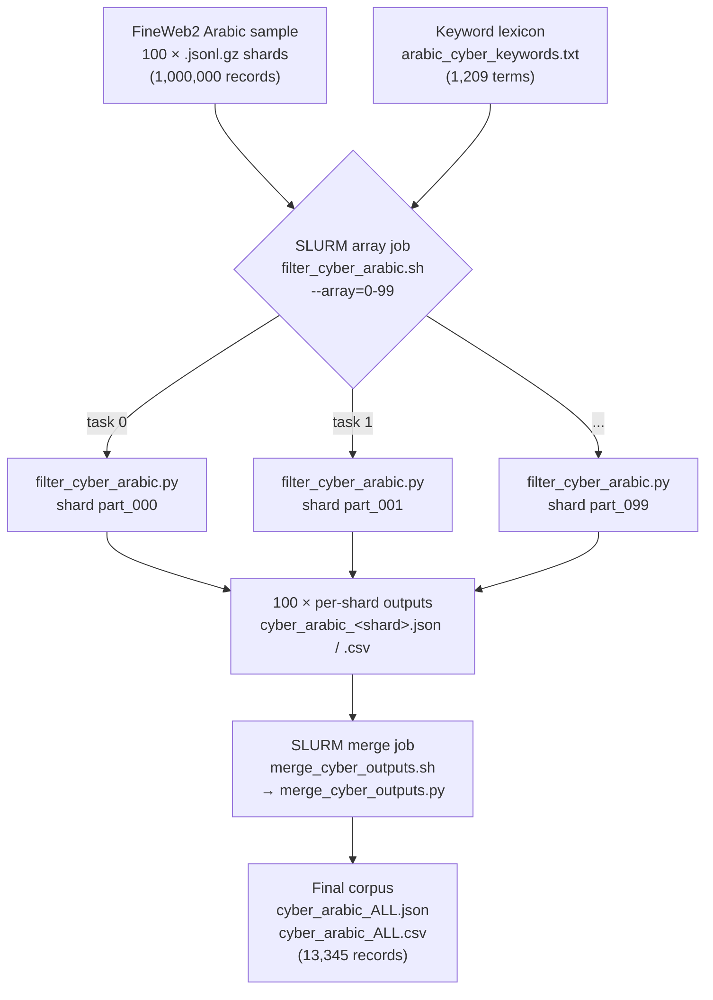

# Arabic Cybersecurity Corpus Filter 🛡️

**Keyword-based extraction of Arabic cybersecurity content from FineWeb2, with a fully explainable evidence trail for every matched record.**


-green)


This project filters a 1,000,000-record sample of Arabic web text from [FineWeb2](https://huggingface.co/datasets/HuggingFaceFW/fineweb-2) down to a **13,345-record domain-specific cybersecurity corpus**, using a curated lexicon of **1,209 Arabic cybersecurity keywords and phrases**. Every record kept in the output carries the exact list of keywords that matched it — so the classification of every single record is human-verifiable, not a black box.

A second **LLM-as-judge evaluation layer** then reads the documents and measures how good the keyword filter actually is: precision, recall, and exactly where it fails — first on a stratified sample, then as a **full-corpus census** in which every record of the expanded ("v2") corpus was individually judged. See [Evaluation](#evaluation-llm-as-judge) below and [`evaluation/`](evaluation).

The resulting corpus is intended as a foundation for training and evaluating Arabic language models in the cybersecurity domain.

---

## Table of contents

- [Overview](#overview)
- [Key numbers](#key-numbers)
- [Pipeline architecture](#pipeline-architecture)
- [Repository structure](#repository-structure)
- [Methodology](#methodology)
  - [1. Keyword lexicon](#1-keyword-lexicon)
  - [2. Whole-word Arabic matching](#2-whole-word-arabic-matching)
  - [3. Explainability by design](#3-explainability-by-design)
  - [4. Parallel processing on SLURM](#4-parallel-processing-on-slurm)
- [Output schema](#output-schema)
- [Corpus statistics](#corpus-statistics)
- [Evaluation (LLM-as-judge)](#evaluation-llm-as-judge)
  - [Can an open 31B model do the judging instead?](#can-an-open-31b-model-do-the-judging-instead)
- [Usage](#usage)
  - [Local (single machine)](#local-single-machine)
  - [HPC cluster (SLURM array job)](#hpc-cluster-slurm-array-job)
- [Engineering challenges & lessons learned](#engineering-challenges--lessons-learned)
- [Data availability](#data-availability)
- [Related work](#related-work)
- [License](#license)

---

## Overview

**FineWeb2** is a massive multilingual web-text dataset extracted from Common Crawl. Its Arabic subset (`arb_Arab`) is distributed as compressed shards (`.jsonl.gz`), where each line is one JSON record containing the raw text plus metadata (source URL, crawl date, Common Crawl dump ID).

The task: **filter this huge volume of general Arabic web text down to only the documents genuinely related to cybersecurity**, producing a domain-specific corpus suitable for downstream Arabic-LLM training or evaluation in the cybersecurity domain.

Three principles drove the design:

1. **Precision over naive matching** — whole-word Arabic matching, not substring matching, to avoid false positives.
2. **Explainability** — every kept record stores the exact keywords that justified keeping it.
3. **Scalability** — embarrassingly parallel processing, one SLURM array task per shard, instead of a slow sequential scan.

## Key numbers

| Metric | Value |
|---|---|
| Input records scanned | **1,000,000** (100 shards × 10,000 records) |
| Records matched (kept) | v1 **13,345** (1,209 kw) → v2 **14,653** (1,233 kw) → **v3 6,041** (tiered rule) |
| Keyword lexicon size | **1,209** → **1,233** Arabic + English terms; **640** of them evidence-tiered |
| Every record LLM-judged | **14,653 / 14,653** (full census, 100%) |
| Measured precision (lenient) | v2 **0.388** → v3 **0.636**, keeping 77% of the strictly-cyber docs |
| Scaled to the full crawl | v4: **370,019** records from **~70M** parquet rows (25 files, 112 GB) |
| v4 measured precision | **0.7211** (full census of all 370,019) — the tiered rule *improved* at 70× scale (v3 0.636) |
| **v5 — every record judged** | **277,418** records at **0.8902** precision [0.8629–0.9137], retaining 92.5% of genuine content |
| Strongest single signal found | **document length** — a `len(text) < 8000` cap alone gives **0.841** precision at zero LLM cost; with judging, **0.943** |
| Open-model judge (31B, local) | binary κ **0.654**, sensitivity **0.926** — and **prompting does not close the graded-relevance gap** ([benchmark](evaluation/JUDGE_BENCHMARK.md)) |
| Common Crawl dumps covered | **96** (from `CC-MAIN-2013-20` to `CC-MAIN-2024-18`) |
| Final outputs | `cyber_arabic_v3_ALL.{json,csv}` (~78 MB) + `_judged.json` (verdict per record) |
| Wall-clock strategy | 100 parallel SLURM tasks (~1–2 min each) instead of hours sequentially |

## Pipeline architecture



**Stage 1 — Parallel filtering.** Each `.jsonl.gz` shard is processed independently by its own SLURM array task. The task streams the shard line-by-line (never loading the whole file into memory), tests each record's `text` field against the compiled keyword pattern, and writes one JSON + one CSV output per shard containing only the matching records.

**Stage 2 — Merging.** Once all array tasks finish, a separate SLURM job concatenates the 100 per-shard outputs into one final `cyber_arabic_ALL.json` (for programmatic use) and `cyber_arabic_ALL.csv` (for manual review in Excel or similar tools).

## Repository structure

```
arabic-cyber-filter/
├── scripts/
│   ├── filter_cyber_arabic.py    # Stage 1: keyword filter (batch or single-shard mode)
│   ├── merge_cyber_outputs.py    # Stage 2: merge per-shard outputs into one corpus
│   ├── filter_cyber_arabic_tiered.py  # v3: TIERED acceptance rule filter (resumable, .done markers)
│   ├── merge_cyber_outputs_tiered.py  # v3 merge (schema-aware: tiers_found, accept_rule)
│   └── llm_judge_api.py          # LLM-as-judge over the whole corpus (Claude Batches API)
├── sbatch_scripts/
│   ├── filter_cyber_arabic.sh    # SLURM array job — one task per shard
│   ├── merge_cyber_outputs.sh    # SLURM merge job — run after the array finishes
│   ├── filter_cyber_tiered.sh    # v3 SLURM array job (cpu-all, resumable: resubmit = resume)
│   └── merge_cyber_tiered.sh     # v3 merge job with .done completeness gate
├── TIERED_RUN_GUIDE.md           # step-by-step: move tier files to the cluster + run v3
├── keywords/
│   ├── arabic_cyber_keywords.txt          # 1,209-term Arabic cybersecurity lexicon (original, unchanged)
│   ├── missing_cybersecurity_keywords.txt # 24 recall-gap terms mined from missed records (mostly English: VPN, Firewall…)
│   ├── all_cyber_keywords.txt             # combined 1,233-keyword lexicon (original + missing, exact-deduped)
│   └── tiers/                             # evidence-tiered lexicon learned from the LLM judge
│       └── tier{1..4}_keywords.txt        #   tier 1 = trustworthy alone … tier 4 = needs 4+ co-hits
├── evaluation/                   # LLM-as-judge verification (see evaluation/README.md)
│   ├── README.md                 #   method overview + folder layout
│   ├── JUDGE_PROTOCOL.md         #   the labelling rubric
│   ├── RESULTS.md                #   written interpretation of the numbers
│   ├── scripts/                  #   make_samples.py, make_unmatched_sample.py, compute_metrics.py
│   ├── samples/                  #   judge-view inputs shown to the LLM
│   ├── judgments/                #   raw per-record verdicts (matched_*.json, unmatched_*.json)
│   ├── chat_judging/             #   full-corpus census: 587 per-chunk verdicts + merged judged_corpus.json (not tracked, ~202 MB)
│   └── results/                  #   metrics.json, judged_sample_*.json/.csv, keyword_tiers_evidence.tsv (per-keyword audit trail)
├── samples/
│   └── sample_output.json        # 5 example records from the final corpus
├── result/                       #  (not tracked) final merged corpus
├── FineWeb2/                     # (not tracked) input shards  *.jsonl.gz
├── output/                       # (not tracked) per-shard filtered outputs
└── logs/                         # (not tracked) SLURM stdout/stderr logs
```

> The `FineWeb2/`, `output/`, `result/`, and `logs/` directories are excluded from git because of their size (~2.4 GB combined). See [Data availability](#data-availability).

## Methodology

### 1. Keyword lexicon

Rather than inventing a keyword list from scratch, this project reuses a vetted, purpose-built resource: the **[Arabic Cybersecurity Glossary](https://github.com/Alsumaitti/arabic-cyber-keywords)** — the output of a previous task in the same research effort, in which an accurate Arabic cybersecurity terminology list was constructed and refined. A snapshot lives in [`keywords/arabic_cyber_keywords.txt`](keywords/arabic_cyber_keywords.txt): 1,209 entries, one per line, mixing single words (e.g. `هاكر` — *hacker*) and multi-word phrases (e.g. `اختراق الشبكات` — *network penetration*). Lines starting with `#` are treated as comments.

Building this task on top of a previous task's verified output — instead of redoing the work — is a deliberate example of how stages of an integrated research project should compound.

### 2. Whole-word Arabic matching

Naive substring matching produces many false positives in Arabic. For example, the keyword `أمن` (*security*) must **not** match inside `الأمنية` (a different inflected form). The filter therefore:

- **Respects Arabic word boundaries.** All keywords are compiled into a single alternation regex wrapped in `\b...\b`. In Python 3's Unicode mode, `\w` includes Arabic letters, so `\b` correctly identifies Arabic word boundaries — a keyword only matches as a complete token.
- **Matches multi-word phrases literally.** A phrase like `اختراق الشبكات` must appear as the full contiguous phrase in normal reading order — its individual words matching separately is not enough.
- **Checks longer phrases first.** Keywords are sorted longest-first before compilation, so a multi-word phrase wins over any shorter sub-phrase contained within it.
- **Compiles once, matches fast.** All 1,209 keywords become one compiled regex, so each of the million records is scanned in a single pass rather than 1,209 separate searches.
- **Optionally normalizes diacritics.** A `--strip-tashkeel` flag removes Arabic diacritics from both text and keywords before matching, for sources with inconsistent diacritization.

### 3. Explainability by design

This is the most strategically important design decision. Instead of emitting an opaque yes/no classification, **every kept record carries a `keywords_found` column** — the exact, de-duplicated list of lexicon terms found in its text. Any researcher reviewing the corpus later can see *precisely why* each record was classified as cybersecurity-related. This evidence trail is essential for any serious data-curation effort that requires downstream human review, and it also enables cheap post-hoc re-filtering (e.g. "keep only records with ≥ 2 distinct keyword hits" — see `--min-keywords`).

### 4. Parallel processing on SLURM

Processing 100 shards sequentially on one node is needlessly slow. Instead, [`sbatch_scripts/filter_cyber_arabic.sh`](sbatch_scripts/filter_cyber_arabic.sh) launches a **SLURM array job** (`--array=0-99`): each task independently

1. rebuilds a stable, alphabetically-sorted, null-byte-safe list of shard paths,
2. selects its shard via `$SLURM_ARRAY_TASK_ID`,
3. runs the filter in single-shard mode, and
4. writes its own output pair — no inter-task communication, no shared write contention.

The design also self-protects: if the array is sized larger than the actual shard count, surplus tasks exit cleanly instead of failing.

## Output schema

Both JSON and CSV outputs share the same six columns:

| Column | Description |
|---|---|
| `text` | Full original Arabic document text from FineWeb2 |
| `dump` | Common Crawl dump ID (e.g. `CC-MAIN-2024-18`) |
| `url` | Source URL of the document |
| `date` | Crawl timestamp |
| `file_path` | Path of the originating Common Crawl WARC segment |
| `keywords_found` | **Evidence trail** — JSON array of the exact lexicon terms matched in `text` |

See [`samples/sample_output.json`](samples/sample_output.json) for five real records from the final corpus.

## Corpus statistics

Computed over the final 13,345-record corpus.

### Top 20 matched keywords (by document frequency)

| # | Keyword (Arabic) | English gloss | Documents |
|---|---|---|---|
| 1 | الأمن السيبراني | cybersecurity | 954 |
| 2 | البرامج الضارة | malware | 937 |
| 3 | أمن المعلومات | information security | 855 |
| 4 | مكافحة الفيروسات | antivirus | 767 |
| 5 | البرمجيات الخبيثة | malicious software | 490 |
| 6 | الهجمات الإلكترونية | cyber attacks | 472 |
| 7 | الجرائم الإلكترونية | cybercrime | 429 |
| 8 | الثغرات الأمنية | security vulnerabilities | 347 |
| 9 | برامج ضارة | malware (indefinite) | 324 |
| 10 | الأمن الإلكتروني | electronic security | 322 |
| 11 | الباب الخلفي | backdoor | 312 |
| 12 | برامج التجسس | spyware | 303 |
| 13 | حصان طروادة | Trojan horse | 294 |
| 14 | ثغرة أمنية | security vulnerability | 271 |
| 15 | فك تشفير | decryption | 263 |
| 16 | الوصول غير المصرح به | unauthorized access | 252 |
| 17 | جدار الحماية | firewall | 250 |
| 18 | البريد المزعج | spam | 237 |
| 19 | الحرب الإلكترونية | cyber warfare | 237 |
| 20 | برمجيات خبيثة | malicious software (indefinite) | 234 |

### Distinct keyword hits per record

| Distinct keywords in record | Records | Share |
|---|---|---|
| 1 | 9,062 | 67.9% |
| 2 | 2,209 | 16.6% |
| 3–5 | 1,610 | 12.1% |
| 6+ | 464 | 3.5% (max: 37 distinct keywords in one document) |

Records with many distinct hits are very likely dedicated cybersecurity articles; single-hit records are candidates for a stricter second-pass review — exactly the kind of triage the `keywords_found` evidence column enables.

### Top source domains

`aljazeera.net`, `tech-wd.com`, `arabic.sputniknews.com`, `arabic.rt.com`, `isecur1ty.org`, `ara.reuters.com`, `support.microsoft.com`, `albayan.ae` — a healthy mix of major Arabic news outlets, dedicated Arabic tech/security sites, and vendor support pages.

## Evaluation (LLM-as-judge)

The keyword filter answers a mechanical question ("does this text contain a cybersecurity term?"), which is not the same as the question we care about ("is this document *about* cybersecurity?"). To measure the gap, a second layer has an LLM (Claude) **read** each document and return a structured verdict — `cyber` / `borderline` / `not_cyber`, a confidence, a one-sentence English justification citing the evidence, and a one-sentence topic summary. This turns the filter from "trust the keywords" into a *measured* classifier with precision and recall.

Everything lives in [`evaluation/`](evaluation): the labelling rubric ([`JUDGE_PROTOCOL.md`](evaluation/JUDGE_PROTOCOL.md)), the sampling and metric scripts, the raw per-record verdicts, and the written interpretation ([`RESULTS.md`](evaluation/RESULTS.md)). Evaluation happened in two rounds: first a stratified **sample** of 300 matched records (with a [TREC-style pooled](evaluation/README.md#recall--how-many-cybersecurity-documents-the-filter-missed) recall estimate), and then a full-corpus **census** — every record judged. **The census below is the authoritative reference; the sample estimates that follow it are kept for the recall/lexicon-gap analysis.**

### Full-corpus census — every v2 record judged (authoritative)

The sample estimates were later superseded by a **complete census**. After the lexicon was expanded to 1,233 keywords and the corpus re-filtered (**"v2", 14,653 records**), *every* record was read and labelled by the LLM judge in a resumable, multi-session in-chat campaign — the whole corpus split into **587 chunks of 25 records**, judged one chunk at a time with a commit-and-push checkpoint after each, so hitting the subscription's rolling ~5-hour usage limit costs at most one chunk and resumes with zero rework. It took **~20 sessions / ~14 h of active work over 5 days** (2026-07-14 → 07-19), at **zero marginal API cost**. Full operational record — chunking, model, timeline, and token/cost accounting — in [`evaluation/chat_judging/CAMPAIGN.md`](evaluation/chat_judging/CAMPAIGN.md). Because this is the whole population, not a 300-record draw, the proportions below are **measured exactly** — no confidence intervals. The merged verdicts (each record + its four judge columns) are in [`evaluation/chat_judging/judged_corpus.json`](evaluation/chat_judging/judged_corpus.json).

| Label | Records | Share |
|---|---|---|
| `cyber` | 3,131 | 21.4% |
| `borderline` | 2,550 | 17.4% |
| `not_cyber` | 8,972 | 61.2% |
| **Total** | **14,653** | 100% |

| Distinct keyword hits | Records | Share | Strict precision (`cyber`) | Lenient (`cyber`+`borderline`) |
|---|---|---|---|---|
| 1 | 9,807 | 66.9% | **0.116** | **0.270** |
| 2 | 2,352 | 16.1% | **0.312** | **0.570** |
| 3–5 | 1,887 | 12.9% | **0.464** | **0.645** |
| 6+ | 607 | 4.1% | **0.631** | **0.778** |
| **Whole corpus** | **14,653** | 100% | **0.214** | **0.388** |

The census confirms the sample's central finding at full resolution — precision rises monotonically with keyword-hit count — but at a **lower absolute level than the v1 sample** (whole-corpus strict 0.21 vs the v1 sample's ~0.35). That is **by design, not regression**: v2 added the recall-driven Latin/English terms (`VPN`, `Firewall`, `Proxy`, `Antivirus` …), which are the corpus's biggest false-positive magnets — they pull in consumer-VPN/antivirus product pages, privacy-policy boilerplate, and auto-generated adware "removal" pages. The census prices that precision-for-recall trade **exactly, per keyword**, which is precisely what the rebuilt tiers (below) act on.

### Precision by keyword-hit count (v1 stratified sample, 300 records)

The single most important finding: **precision is driven almost entirely by how many distinct keywords a record hit.** A record matched by one incidental keyword is a weak signal; three or more is a strong one.

| Distinct keyword hits | Corpus share | n judged | Strict precision (`cyber`) | Lenient precision (`cyber`+`borderline`) |
|---|---|---|---|---|
| 1 | 67.9% | 100 | **0.21** (0.14–0.30) | **0.58** (0.48–0.67) |
| 2 | 16.6% | 80 | **0.51** (0.41–0.62) | **0.80** (0.70–0.87) |
| 3–5 | 12.1% | 60 | **0.75** (0.63–0.84) | **0.98** (0.91–1.00) |
| 6+ | 3.5% | 60 | **0.97** (0.89–0.99) | **1.00** (0.94–1.00) |
| **Corpus-weighted** | 100% | 300 | **≈ 0.35** | **≈ 0.68** |

_(Wilson 95% confidence intervals in parentheses; strata combined using their true corpus weights.)_

**What this means, and why it's actionable:** the single-hit stratum is 68% of the corpus but only ~21% of it is substantively about cybersecurity — the rest are metaphorical matches ("Trojan horse" in politics, "back door" as a literal door), boilerplate privacy-policy clauses, and spam pages with an incidental "VPN" or "firewall". At 3+ hits, lenient precision is ≥ 98%. So filtering the existing corpus on `len(keywords_found) >= 2` — which the explainable `keywords_found` column makes trivial — lifts strict precision from ~0.35 to roughly ~0.6 and lenient precision to ~0.85 while keeping essentially all the genuine content. **The evidence trail doubles as a confidence score.** Full breakdown and the recurring false-positive patterns are in [`evaluation/RESULTS.md`](evaluation/RESULTS.md).

### Tiered keywords — not all keywords are equal

The flat `--min-keywords 2` fix above throws away *every* single-hit record, including the genuinely good ones. The judge data supports something sharper: **measure each keyword's individual reliability** and tier the lexicon by how much co-occurring evidence a keyword needs before its match is trustworthy. A record judged cyber on the strength of `الأمن السيبراني` *alone* proves that keyword self-sufficient (Tier 1); a keyword only ever seen in 4+-hit cyber records has never carried a document by itself (Tier 4). Crucially, a keyword whose solo matches are *mostly false positives* is demoted regardless — across the full census `VPN` carried **167** records to a `cyber`/`borderline` verdict on its own but sank **414** into `not_cyber` (consumer-VPN product pages), so despite hundreds of solo "wins" it is **not** Tier 1; `الأبواب الخلفية` (backdoors, plural) went 3 good vs 71 not_cyber. In all, **213** keywords were demoted out of Tier 1 this way. Rebuilt on the full census (**714** keywords with at least one judged appearance), the result is **136 / 295 / 57 / 152** keywords in tiers 1–4 ([`keywords/tiers/`](keywords/tiers)), each assignment backed by a per-keyword audit trail ([`evaluation/results/keyword_tiers_evidence.tsv`](evaluation/results/keyword_tiers_evidence.tsv)), plus **74** keywords that earned **no** tier because every judged appearance was not_cyber (e.g. `تدقيق أمني` / `حاجز الحماية` — literal "security audit" / "protective barrier" false positives). Method, demotion rule, tier-based filtering recipe, and coverage caveats: [`evaluation/README.md`](evaluation/README.md#tiered-keywords--learning-each-keywords-evidential-weight).

**The second-generation filter, measured.** The tier system is not just a lexicon — it drives an acceptance rule (*keep a record iff it matches ≥ 1 Tier-1 keyword, or ≥ 2 of tier ≤ 2, or ≥ 3 of tier ≤ 3, or ≥ 4 tiered keywords*). Because the census labels **every** record, [`evaluation/scripts/apply_tier_filter.py`](evaluation/scripts/apply_tier_filter.py) measures it exactly: the tiered rule lifts lenient precision from **0.39 → 0.64** while retaining **68%** of all genuine records — and **strictly beats a blind `min ≥ 2` threshold on both precision *and* recall** (0.636 P / 0.677 retention vs 0.625 / 0.534), for the best F1 (0.656) of any rule. The same census exposes **74 net-liability keywords** whose every appearance was `not_cyber` — a measured review-and-drop list in [`keywords/deletion_candidates.txt`](keywords/deletion_candidates.txt). Full table, baselines, and the in-sample caveat: [`evaluation/RESULTS.md`](evaluation/RESULTS.md).

**Shipped as the v3 corpus.** The rule was implemented as a production filter and re-run over the full **1,000,000-record** FineWeb2 sample (100-task `cpu-all` SLURM array, resumable — [`TIERED_RUN_GUIDE.md`](TIERED_RUN_GUIDE.md)), yielding **6,041 documents** (`result/cyber_arabic_v3_ALL.{json,csv}`). The cluster run reproduced the offline census prediction **exactly — 6,041 records, clause for clause** (3,253 / 2,780 / 6 / 2) — despite reaching it by a completely different path, and a text-hash join confirmed **0 records outside the judged census**. Since v3 ⊂ v2, every record ships **with its LLM verdict attached** (`cyber_arabic_v3_ALL_judged.json`: 2,398 `cyber` · 1,446 `borderline` · 2,197 `not_cyber`). Details: [`evaluation/RESULTS.md` § Produced at scale](evaluation/RESULTS.md#produced-at-scale--and-independently-validated).

### Recall

Recall was estimated by [TREC-style pooling](evaluation/README.md#recall--how-many-cybersecurity-documents-the-filter-missed) over the 986,655 rejected records: a broad safety-net regex flagged 15,535 candidate misses, of which ~15.8% (judged) were genuinely cybersecurity — extrapolating to **~2,460 false negatives**, while a random sample of the ~971k records outside the net found none. Against ~9,070 kept true positives:

| Metric (lenient) | Value |
|---|---|
| **Estimated recall** | **≈ 0.79** |
| **F1** (precision × recall) | **≈ 0.73** |

The misses are documents that describe cybersecurity in general Arabic the strict lexicon lacks — a report on Pegasus spyware, Israel's Unit 8200, a WiFi-cracking story, SEC breach rules — precisely what a lexicon expansion would recover. See [`evaluation/RESULTS.md`](evaluation/RESULTS.md) for the estimate's sensitivity caveat.

### Closing the gap: mined keywords & a combined lexicon

The recall miss was turned into concrete fixes. Mining the missed records for cybersecurity terms absent from the lexicon surfaced **24 verified-new keywords** ([`keywords/missing_cybersecurity_keywords.txt`](keywords/missing_cybersecurity_keywords.txt)) — and the dominant gap is **Latin/English terms** the Arabic-only glossary never listed (`VPN` appears in **605** missed records, then `Antivirus`, `Proxy`, `Hacker`, `Firewall`, `Malware`, …). The reason is structural, not an oversight: cybersecurity vocabulary is coined in English and enters Arabic writing **untranslated**, so Arabic security articles are code-switched and frequently name a concept only by its English token — which matched none of the 1,209 Arabic entries and was silently dropped. The full explanation (why the terms recur, why they were missing, and what their absence cost) and the mining pipeline are in [`evaluation/README.md`](evaluation/README.md#keyword-gap-mining-turning-the-recall-miss-into-lexicon-fixes). A ready-to-use merged lexicon of **1,233** keywords (original 1,209 + the 24 new, exact-deduped) is in [`keywords/all_cyber_keywords.txt`](keywords/all_cyber_keywords.txt); the original lexicon file is left unchanged.

### Judging the whole corpus

The whole corpus **was** judged this way — that is the [full-corpus census](#full-corpus-census--every-v2-record-judged-authoritative) above (all 14,653 v2 records), produced by an in-chat, resumable multi-session campaign and merged into [`evaluation/chat_judging/judged_corpus.json`](evaluation/chat_judging/judged_corpus.json). To reproduce it non-interactively (or judge a fresh corpus), [`scripts/llm_judge_api.py`](scripts/llm_judge_api.py) runs the same rubric through the **Claude Message Batches API** (50% of standard price, structured-output JSON schema enforced), writing the corpus back out with the four judge columns appended, resumable per chunk. Rough cost at defaults: ~USD 80–110 for the full corpus.

```bash
export ANTHROPIC_API_KEY=sk-ant-...        # or: ant auth login
python scripts/llm_judge_api.py \
    --input  result/cyber_arabic_ALL.json \
    --out-prefix result/cyber_arabic_ALL_judged \
    --limit 20                              # smoke-test on 20 records first; drop --limit for the full run
```

### Can an open 31B model do the judging instead?

Frontier judging is what makes careful curation expensive, and that cost falls
hardest on exactly the languages whose corpora most need curating. So we tested
the substitution directly: **`gemma-4-31B-it` on local H200s against the
frontier census**, on a blind 1,992-record stratified set (gold labels never left
the local machine). Full write-up: **[`evaluation/JUDGE_BENCHMARK.md`](evaluation/JUDGE_BENCHMARK.md)**.

| | zero-shot | few-shot (11 exemplars) |
|---|---|---|
| Cohen κ, 3-way | 0.419 | **0.422** |
| Cohen κ, binary (cyber-ish vs not) | 0.651 | **0.654** |
| `cyber` recall | 0.992 | 0.992 |
| `borderline` recall | 0.146 | **0.146** |

**The answer is split, and the split is the interesting part.**

For the **binary** accept/reject decision — the decision the tiered filter
actually makes — the open model is a usable instrument: κ 0.654, 85.2%
agreement, sensitivity 0.926, and across 664 truly-cyber documents it never once
returned `not_cyber`.

For **graded** relevance it fails, and *the failure is not fixable by prompting*.
It cannot separate "about cybersecurity" from "mentions cybersecurity", calling
468 of 664 `borderline` documents `cyber`. Eleven worked exemplars aimed squarely
at that weak class moved κ by **+0.003** and `borderline` recall by **exactly
zero** — while changing 24.2% of the generated justifications, which proves the
exemplars were applied and simply did not help. Agreement also *falls* as keyword
density rises (0.693 at one hit → 0.526 at four), because more security
vocabulary is precisely the signal the model over-reads.

What makes this usable anyway: a biased classifier with a *measured* operating
point still yields unbiased population estimates. Rogan–Gladen inverts it —
`p_true = (p_obs − 0.295) / 0.630` — which reproduces the validation set's true
prevalence exactly (0.667 vs 0.667). So the practical recipe is a **hybrid**:
spend frontier judgments once to build the reference standard and calibrate the
open model, then let the open model run at corpus scale with its bias corrected
arithmetically. That is what measures v4:

```bash
sbatch sbatch_scripts/sample_v4_for_judging.sh   # rule-stratified sample (CPU)
sbatch sbatch_scripts/judge_v4_sample.sh         # judge on 2 H200s, resumable
python evaluation/scripts/estimate_v4_precision.py \
    --pred "evaluation/judge_benchmark/gemma_v4_P2_p*.jsonl" \
    --meta evaluation/judge_benchmark/v4_sample_meta.jsonl --show-cal
```

Sampling is stratified by **acceptance rule** (`tier1_hit`, `two_tier2_hits`,
`three_tier3_hits`, `four_plus_hits`) so the estimate also says *which door into
the corpus leaks* — and dropping a rule that proves clearly weaker raises corpus
precision with no further judging at all.

## Usage

Requires **Python 3.9+** — standard library only, no third-party dependencies.

### Local (single machine)

Batch mode — scan every `.jsonl.gz` in a folder:

```bash
python scripts/filter_cyber_arabic.py \
    --input-dir  FineWeb2 \
    --keywords   keywords/arabic_cyber_keywords.txt \
    --out-prefix output/cyber_arabic
```

Useful options:

| Flag | Effect |
|---|---|
| `--input-file PATH` | Single-shard mode (what the SLURM array uses) |
| `--strip-tashkeel` | Strip Arabic diacritics from text *and* keywords before matching |
| `--min-keywords N` | Keep only records with ≥ N distinct keyword hits (default 1) |
| `--limit-files N` | Batch mode: process only the first N shards (quick smoke test) |

Then merge the per-shard outputs:

```bash
python scripts/merge_cyber_outputs.py \
    --dir        output \
    --out-prefix result/cyber_arabic_ALL
```

### HPC cluster (SLURM array job)

> Adjust the absolute paths at the top of both `.sh` scripts (they reflect the original cluster layout), and set the conda environment to one that has Python 3.9+.

1. **Count your shards and size the array:**

   ```bash
   ls FineWeb2/*.jsonl.gz | wc -l        # e.g. 100 shards
   # then set  #SBATCH --array=0-99  in filter_cyber_arabic.sh
   ```

2. **Submit the filtering array job** (one task per shard):

   ```bash
   sbatch sbatch_scripts/filter_cyber_arabic.sh
   ```

3. **After all tasks complete, submit the merge job:**

   ```bash
   sbatch sbatch_scripts/merge_cyber_outputs.sh
   ```

   The merge is deliberately a proper sbatch job with 32 GB of memory — **not** an interactive login-node command (see lessons learned below).

## Engineering challenges & lessons learned

Real problems hit during execution, and how they were solved:

**1. Arabic text appeared garbled when opening the CSV in Excel.**
The CSV bytes were perfectly valid UTF-8, but Excel does not auto-detect UTF-8 in CSV files without a byte-order mark — it falls back to a legacy locale codepage and renders every Arabic character as mojibake. Fix: write the CSV with the `utf-8-sig` encoding (UTF-8 + BOM). Excel now opens the file correctly with zero manual steps for reviewers.

**2. The merge process was killed when run interactively on the login node.**
The cluster enforces strict resource limits on interactive login-node processes; merging hundreds of megabytes of JSON crossed them and the process was force-killed. Fix: promote the merge to a first-class sbatch job (`merge_cyber_outputs.sh`) with an explicit 32 GB memory allocation — heavy processing belongs in the scheduler, not the terminal.

**3. Code edits on the local machine silently failed to reach the cluster.**
Several job runs failed because an upload didn't actually transfer the updated script, so SLURM executed a stale version without any visible warning. Lesson: after every upload, verify the *content* of the remote file (hash or key lines) instead of trusting that the transfer succeeded.

## Data availability

The large artifacts are intentionally not tracked in this repository:

| Artifact | Size | How to obtain |
|---|---|---|
| `FineWeb2/*.jsonl.gz` (input) | ~1.7 GB | Sample of the `arb_Arab` subset of [FineWeb2 on Hugging Face](https://huggingface.co/datasets/HuggingFaceFW/fineweb-2) (1M records, 100 shards × 10k) |
| `output/` (per-shard results) | ~365 MB | Regenerate with the array job — deterministic given the same inputs |
| `result/cyber_arabic_ALL.{json,csv}` | ~365 MB | Regenerate with the merge job |

The whole pipeline is deterministic: same shards + same keyword list ⇒ byte-identical corpus (modulo shard ordering, which is stabilized by sorting).

## Related work

- **[Alsumaitti/arabic-cyber-keywords](https://github.com/Alsumaitti/arabic-cyber-keywords)** — the Arabic Cybersecurity Glossary that this filter consumes as its lexicon; a prior task in the same research project.
- **[FineWeb2](https://huggingface.co/datasets/HuggingFaceFW/fineweb-2)** — the multilingual Common Crawl-derived source corpus.

## License

[MIT](LICENSE) © 2026 Osamah Alsumaitti
